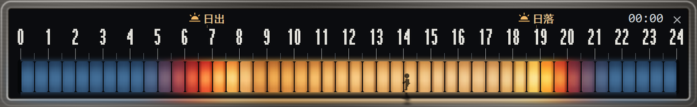
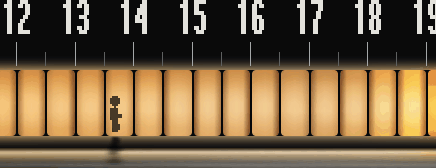

# 24 小时倒计时

一个常驻 Windows 桌面的小钟，用 48 格灯珠显示今天还剩多少时间。当地零点，整条灯带亮起；之后每过半小时，便有一格渐渐熄灭。还亮着的地方，住着一个有自己作息的像素小人。



**直接运行**　下载 [Windows x64 便携版](https://github.com/ashiho-0702/24-hour-countdown/raw/refs/heads/main/dist/24HourCountdown.exe)，双击 `24HourCountdown.exe` 即可。设置保存在当前用户的 `%LOCALAPPDATA%\24HourCountdown\settings.ini`。

## 灯珠里的小人

小人只在整格亮着的灯珠里活动。它有时来回走，有时小跑一段，也会停下来读书、敲键盘、吃饭、伸懒腰、睡觉、打游戏或跳舞。走近边框时，还能看到脚下跟着移动的影子。



| 什么时候点它 | 它会怎么做 |
| --- | --- |
| 散步时 | 转个身，沿着亮区往回走。 |
| 跑步时 | 往前一扑，趴一会儿，再撑起来继续跑。趁它趴着再点一下，还会冒出一句「地板挺结实。」 |
| 忙别的事时 | 头顶会冒出一个白色气泡。读书时惦记「他们什么时候在一起？」，玩游戏时嘀咕「刚才那下手柄没反应！」。每个动作都有三句心里话，再点会换一句。 |

## 桌面操作

- **移动和置顶**　按住小人以外的表盘拖动，松手后小窗会回到屏幕可见范围，并记住位置。默认置顶，右键可切换。
- **开机自动启动**　首次运行后，默认在当前用户登录 Windows 时启动。右键选择「设置…」，取消勾选「开机自动启动」并确定，即可关闭。移动便携版后，手动运行一次新位置的 EXE 即可更新启动路径。
- **时区与日照地点**　在「设置…」里可以跟随电脑时区，也可以手选时区，再选城市或输入经纬度。「白天与黑夜」会根据当地日出、日落，把夜蓝、晨昏的红黄与白天的琥珀色连成渐变。
- **换配色**　右键选择「配色…」可预览全天 48 格灯光。除了日照配色，还有红紫蓝、深蓝到薄荷等六种纯色渐变。
- **隐藏和退出**　点右上角的叉可收起小窗，点系统托盘图标可再次显示。要结束程序，在右键菜单中选「退出程序」。

## 从源码构建

使用 C++17、Win32、GDI 和 GDI+。在 Windows 上安装 Visual Studio 2022 Build Tools，选中「使用 C++ 的桌面开发」及 Windows SDK，然后在仓库目录的 PowerShell 中运行：

```powershell
.\build.ps1
```

生成的单文件程序位于 [dist/24HourCountdown.exe](dist/24HourCountdown.exe)。
